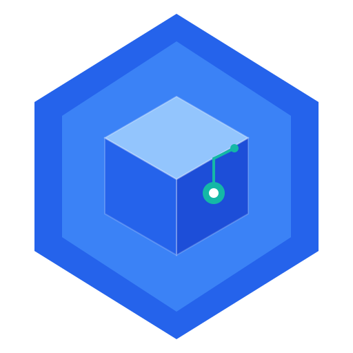

<p align="center">
  
</p>

<h1 align="center">InventAI/o</h1>

<p align="center">
  <strong>Sistema Inteligente de Consulta y Gestión Logística para Distribuidores de Abarrotes</strong>
</p>

<p align="center">
  
  
  
  
  
</p>

---

## Descripción

InventAI/o es un sistema inteligente de consulta y soporte a la toma de decisiones para distribuidores de abarrotes pequeños y medianos en Colombia. La aplicación no captura datos transaccionales; se especializa exclusivamente en análisis, predicción y recomendación.

**Hoy funciona** (Release 2, `v2.0.0`, en local):

- **Bodega de datos analítica** con esquema estrella (PostgreSQL 16), cargada con las ventas reales de un distribuidor (enero de 2022 a diciembre de 2025) y una foto de su inventario físico al 31 de diciembre de 2025
- **Pronóstico de demanda** a 15 días hábiles por segmento: LightGBM cuantílico con calibración conformal en la rama de demanda intermitente y una base de media móvil con cuantil empírico en las ramas de demanda suave. Lo sirve `ml_service`, que también calcula las **recomendaciones de compra a proveedor** (punto de pedido, nivel objetivo y calendario fijo) **y de traslado entre ubicaciones**
- **Core API** (FastAPI) con autenticación JWT y tres roles: gerente, administrador de sucursal y administrador de bodega
- **Alertas** por reglas y con IA (riesgo de desabastecimiento y sobrestock previstos)
- **Aplicación web** (React, Vite y Tailwind) con seis pantallas: Dashboard, Inventario, Alertas, Reportes, Predicciones y Recomendaciones
- **Vera**, el asistente conversacional: una ventana de chat, disponible en todas las pantallas, que responde en español con streaming. Por detrás, `nlp_agent` usa un modelo autoalojado (Qwen3 8B con Ollama, sin APIs externas) y 11 herramientas de solo lectura: diez consultan el Core API con el token de quien pregunta y una busca en el glosario del negocio. Ver [`docs/NLP-AGENT.md`](docs/NLP-AGENT.md)
- **CI/CD** con GitHub Actions e imágenes de producción publicadas en GHCR (ver más abajo)

**Está en el plan** (el detalle vive en Jira, proyecto INV): el despliegue en AWS (staging en el Release 3 y producción en el Release 4), la PWA instalable con Dashboard y Alertas sin conexión, y que Vera responda cómo usar la aplicación. Hoy la aplicación corre en local y se abre en el navegador.

## Arquitectura

```
┌─────────────────────────────────────────────────────────┐
│              Aplicación web (React + Vite)              │
│      Dashboard · Inventario · Alertas · Reportes ·      │
│        Predicciones · Recomendaciones · chat Vera       │
├─────────────────────────────────────────────────────────┤
│                    Core API (FastAPI)                   │
│     Auth · Consulta · Reportes · Alertas · ML · Chat    │
├──────────────────┬───────────────────┬──────────────────┤
│    ml_service    │     nlp_agent     │  PostgreSQL 16   │
│    LightGBM ·    │ Qwen3 8B (Ollama) │    bodega con    │
│   traslados y    │  11 herramientas  │    esquema en    │
│     compras      │  de solo lectura  │     estrella     │
└──────────────────┴───────────────────┴──────────────────┘
```

Nginx sirve la aplicación y le pasa `/api` al Core API. El chat también entra por el Core API (`/api/chat`, con SSE), que valida el token y los permisos antes de llamar al agente. El agente no publica puertos y consulta los datos a través del Core API, con el token de quien pregunta. El caché del Core API es en memoria; Redis está en el compose para cuando haya más de un servidor.

## Stack Tecnológico

| Capa | Tecnología |
|------|-----------|
| Base de datos | PostgreSQL 16 (esquema estrella) |
| API | FastAPI + Pydantic (Core API, servicio de pronóstico y agente) |
| Modelos | LightGBM; MLflow para los experimentos |
| Agente conversacional | Ollama con Qwen3 8B, herramientas de solo lectura y BM25 sobre el glosario |
| Aplicación web | React 18, Vite, Tailwind CSS y Recharts |
| Servidor web | Nginx (imagen sin root) |
| Contenedores | Docker Compose; imágenes de producción en GHCR |
| CI/CD | GitHub Actions, Trivy y Dependabot |
| Planeado | Despliegue en AWS y PWA instalable |

## Estructura del Repositorio

```
InventaIO/
├── api/                       # Core API (FastAPI): auth, consulta, inventario, reportes, alertas, ml
├── ml_service/                # Servicio de pronóstico: prediccion/, transferencias/, compras/
├── nlp_agent/                 # Agente conversacional con Ollama (INV-30) -- ver docs/NLP-AGENT.md
├── frontend/                  # Aplicación web (React + Vite): src/, Dockerfile, nginx.conf
├── database/
│   ├── init.sql               # DDL esquema estrella
│   └── test-dw-real.SQL       # Verificación de la bodega cargada
├── etl_real/                  # DW real (INV-60/61) -- ver etl_real/README.md
├── etl/                       # Pipeline del dataset simulado original (Favorita)
├── notebooks/                 # EDA + features + modelos (INV-14/15/17) y prerregistro
├── models/                    # Modelos de Nivel 1 serializados, con SHA256SUMS
├── docs/
│   ├── AMBIENTE-DESARROLLO.md # Cómo levantar todo desde cero
│   ├── CI-CD.md               # Pipeline, comandos locales y configuración del repositorio
│   ├── mockups/               # Pantallas HTML y demo navegable (diseño original)
│   └── INV-*.md               # Historias de usuario y decisiones documentadas
├── .github/                   # Workflows (ci.yml, images.yml), Dependabot y plantilla de PR
├── scripts/                   # Utilidades (Ollama en WSL, descarga de modelos, tiempos de Nginx, init-repo)
├── docker-compose.yml         # PostgreSQL, Redis, pgAdmin, Core API, ml-service, nlp-agent, web (perfil `web`) y ollama (perfil `llm`)
├── docker-compose.gpu.yml     # GPU para el contenedor de Ollama (opcional)
├── docker-compose.verify.yml  # Comprobación de las imágenes de producción
├── requirements-dev.txt       # pytest, ruff y pip-audit con las versiones del CI
├── ruff.toml                  # Configuración de ruff de los servicios de Python
├── .env.example
├── CONTRIBUTING.md            # Branching + commits
└── README.md
```

`ml_service` carga y sirve los modelos de `models/` (INV-20). Los cuadernos de `notebooks/` son el pipeline de investigación y no forman parte del stack en ejecución; están documentados en `docs/INV-14-eda-resumen.md`, `docs/INV-15-feature-engineering.md` y `docs/INV-17-modelo-baseline.md`.

## Inicio Rápido

El ambiente de referencia es Ubuntu (en WSL2 si se trabaja desde Windows) con Docker. La guía completa, con requisitos y verificaciones, es [`docs/AMBIENTE-DESARROLLO.md`](docs/AMBIENTE-DESARROLLO.md). Los datos del negocio no están en el repositorio: se entregan por separado y se cargan en el paso 3.

```bash
# 1. Clonar y configurar
git clone https://github.com/ddelgadillod/InventaIO.git ~/InventaIO
cd ~/InventaIO
cp .env.example .env

# 2. Levantar la bodega
docker compose up -d postgres

# 3. Construir y cargar la bodega con los datos reales:
#    secciones 3 a 5 de docs/AMBIENTE-DESARROLLO.md (ETL de etl_real/ y cargar_postgres.py)

# 4. Levantar el servicio de pronóstico y el Core API
docker compose up -d --build ml-service api

# 5. Vera (opcional): Ollama nativo en WSL, el modelo y el agente (docs/NLP-AGENT.md)
bash scripts/ollama_wsl.sh iniciar
bash scripts/descargar_modelos_llm.sh qwen3:8b
docker compose up -d --build nlp-agent

# 6. Aplicación web en desarrollo (Node 22)
cd frontend && npm install && npm run dev      # http://localhost:5173
# o compilada detrás de Nginx, como en producción:
# docker compose --profile web up -d --build --no-deps web   # http://localhost:8080
```

Cómo correr las pruebas y los controles del CI en local: [`docs/CI-CD.md`](docs/CI-CD.md).

## CI/CD

Dos workflows de GitHub Actions corren en cada PR y push a `develop` y `main`
(detalle, comandos locales y configuración del repositorio en
[`docs/CI-CD.md`](docs/CI-CD.md)):

- **CI** (`ci.yml`): sin datos reales.
  - En `api`, `ml_service`, `etl_real` y `nlp_agent`: ruff, pruebas con cobertura mínima y auditoría de dependencias.
  - En el frontend: ESLint, Vitest, `npm audit` y el build.
  - El OpenAPI versionado y los SHA-256 de los modelos se comprueban.
- **Imágenes** (`images.yml`): las imágenes de producción de `api`, `ml-service`, `nlp-agent` y `web`, sin root y con healthcheck.
  - Las escanea Trivy y verifica que arranquen sanas.
  - Las publica en `ghcr.io/ddelgadillod/inventaio-*` en `develop`, `main` y las etiquetas `vX.Y.Z`.

Las pruebas de integración contra la bodega real no corren en el CI, porque los
datos del negocio no están en GitHub: se corren en local antes de cada merge.
El despliegue en AWS es de INV-34.

## Datos de la Bodega

| Métrica | Valor |
|---------|-------|
| Productos | 4.449 en 33 categorías |
| Ubicaciones | 3 sucursales (PRINCIPAL, LA 21 y GLORIETA) y la Bodega Central |
| Proveedores | 10, simulados: los reportes de ventas no traen compras ni plazos |
| Ventas | 2.056.210 registros, del 2 de enero de 2022 al 31 de diciembre de 2025 |
| Inventario | 11.101 registros: una sola foto, al 31 de diciembre de 2025 |
| Calendario | 2.190 días (2022–2027) con 108 festivos de Colombia (Ley Emiliani) |

## Metodología

**Scrum + CRISP-DM**: cinco releases y sprints de tres semanas. El plan y el avance viven en Jira (proyecto INV).

| Release | Alcance |
|---------|---------|
| R1 · MVP Operacional | Bodega de datos, Core API y pantallas básicas (publicado en abril de 2026) |
| R2 · Predictivo y Conversacional v1 | Pronóstico y servicio de predicción, recomendaciones de compra y de traslado, vistas de Predicciones y Recomendaciones, alertas con IA, CI/CD, el agente conversacional y el chat Vera (`v2.0.0`, octubre de 2026) |
| R3 · Primera versión en la nube | Pronóstico evaluado con las ventas de 2026, reentrenamiento programado, hardening y primer despliegue en AWS (staging) |
| R4 · Producción | Producción en AWS, PWA, Vera responde cómo usar la aplicación, pruebas con usuarios y sus ajustes |
| R5 · Validación y entrega | Documentación final, demostración y entrega académica, monitoreo del pronóstico y mejoras de Vera |

## Diseño de Interfaces

Hoy la aplicación tiene seis pantallas (Dashboard, Inventario, Alertas, Reportes, Predicciones y Recomendaciones), con menú lateral y datos según el rol. El diseño original planteaba un enfoque **chat-first**, con el agente conversacional como pantalla principal. Se optó por una ventana de Vera, flotante o maximizada, que acompaña a todas las pantallas y conserva la conversación al cambiar de una a otra.


> 📂 Demo navegable disponible en [`docs/mockups/inventaio-demo.html`](docs/mockups/inventaio-demo.html)

### Paleta de Colores

| Color | Hex | Uso |
|-------|-----|-----|
| 🔵 Blue 600 | `#2563EB` | Primario, botones, links |
| 🔷 Navy 900 | `#1E3A5F` | Sidebar, headings |
| 🟢 Teal 500 | `#14B8A6` | Acento, agente IA, FAB |
| ⬜ Slate 50 | `#F8FAFC` | Fondo general |

### Semáforo de Inventario (WCAG AA)

| Estado | Color | Icono | Significado |
|--------|-------|-------|------------|
| ✅ OK | `#16A34A` | ✓ | Cobertura > 7 días |
| ⚠️ Bajo | `#CA8A04` | ⚠ | Cobertura 3–7 días |
| 🔴 Crítico | `#DC2626` | ✕ | Cobertura < 3 días |
| 🟣 Inconsistencia | `#7008E7` | ◆ | Stock negativo en la foto: verificar el conteo |

## Autor

**Diego Alejandro Delgadillo Durán** — Código 2508140-7729

Maestría en Computación para el Desarrollo de Aplicaciones Inteligentes
Universidad del Valle — 2026


## Licencia

Este proyecto es parte de un trabajo académico de maestría. Todos los derechos reservados.
