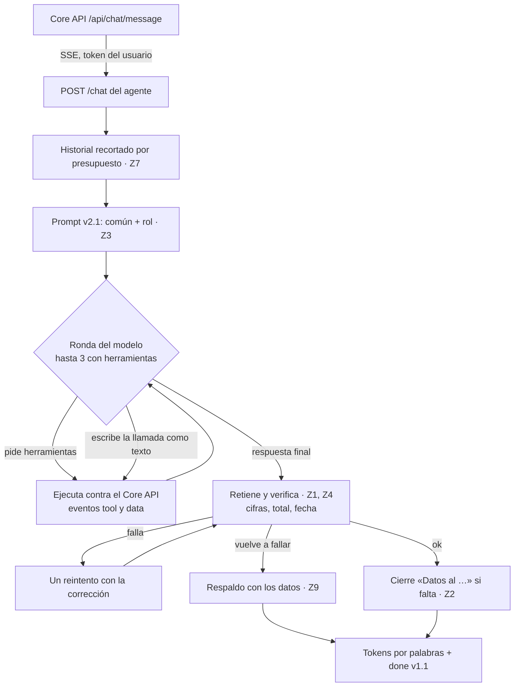

# INV-33 · Prompts, fidelidad y flujo conversacional del agente

Cómo responde el agente después de INV-33, qué se decidió y qué se midió. Es la referencia para mantenerlo y para la versión 3. Los requerimientos, con cada decisión y su porqué, están en `docs/INV-33-requerimientos.md`; el contrato con el Core API y el panel, en la §4.3 de `docs/INV-30-requerimientos.md`.

## 1. El agente que se integra

El que corre por defecto (`MEJORAS=ninguna`) es **el del 22-oct**:
- el prompt **v2.1** por rol;
- la respuesta **retenida y verificada** antes de mostrarla;
- un reintento y una respuesta de respaldo;
- el cierre con la fecha de los datos;
- el historial recortado por presupuesto;
- las sugerencias en `done`.

Las mejoras que se construyeron después (§5) están en el código **detrás de interruptores apagados**. En los tres holdouts no superaron a este agente en acierto (§6).

## 2. Flujo de una pregunta

**Límites:**

| Límite | Valor | Para qué |
| --- | --- | --- |
| Tiempo total | 120 s (`LLM_TIMEOUT_S`) | Si se pasa, evento `error` con `tiempo_agotado` |
| Silencio | `: ping` cada 15 s | Mientras se verifica no salen tokens |
| Tokens por ronda | 2.048 (`LLM_TOPE_RESPUESTA`, 24-oct) | Corta una generación desbocada; las respuestas normales llegan a ~450 (p95) |

**`done` v1.1:**

| Campo | Qué es |
| --- | --- |
| `fidelidad` | `ok`, `reintento` o `respaldo` |
| `respaldo` | `true` si la respuesta es la de respaldo |
| `sugerencias` | Hasta 3 preguntas de seguimiento según la herramienta usada |
| `turnos_recortados` | Turnos del historial que no entraron en el presupuesto |

## 3. Las decisiones Z, dónde viven

| # | Decisión | Código |
| --- | --- | --- |
| Z1 | Retener la respuesta final y verificarla antes de mostrarla (`FIDELIDAD_RETENER`) | `agente/bucle.py` |
| Z2 | Cierre fijo con la fecha de los datos si la respuesta no la dice | `agente/fidelidad.py` (`Verificacion.cierre`) |
| Z3 | `prompts/v2/`: parte común y una por rol; el v1 de INV-32 queda congelado | `prompts/v2/`, `agente/prompt.py` |
| Z4 | El verificador: cifras sin respaldo, total omitido y fecha | `agente/fidelidad.py` |
| Z5 | Pista de ambigüedad por categorías en el inventario | `herramientas/catalogo.py` |
| Z6 | Sugerencias deterministas en `done` | `agente/sugerencias.py` |
| Z7 | Historial por presupuesto (1.500 tokens; 500 en el perfil corto) | `agente/historial.py` |
| Z8 | Perfil corto para CPU (`PERFIL_PROMPT=corto`) | `prompts/v2/corto.md` |
| Z9 | Respuesta de respaldo solo con las tablas consultadas | `agente/fidelidad.py` (`respaldo`) |
| Z10 | Frases fijas para fuera de alcance, sin datos, sin permiso, usuarios e instrucciones | `prompts/v2/comun.md` |
| Z11 | El arnés mide el borrador y la respuesta final | `evaluacion/arnes.py` |
| Z12 | Un solo verificador para el agente y el calificador | `evaluacion/calificacion.py` importa `agente/fidelidad.py` |
| Z13 | «Solo los filtros que la pregunta nombra», con un ejemplo negativo | `prompts/v2/` |
| Z14 | Registro sin texto: fidelidad, cifras sin respaldo, turnos recortados | `chat/router.py` |

## 4. Configuración

| Variable | Por defecto | Para qué |
| --- | --- | --- |
| `PROMPT_VERSION` | `v2` | `v1` es el prompt congelado de INV-32 |
| `PERFIL_PROMPT` | `completo` | `corto` para CPU (Z8) |
| `FIDELIDAD_RETENER` | `true` | Con `false`, transmite como antes, sin reintento ni respaldo |
| `HISTORIAL_PRESUPUESTO` | el del perfil | En tokens |
| `MEJORAS` | `ninguna` | Interruptores de §5, separados por coma, o los grupos `activas` y `final` |
| `LLM_TOPE_RESPUESTA` | 2048 | `num_predict` de Ollama |

## 5. Interruptores (apagados por defecto)

| Interruptor | Qué hace | Medido |
| --- | --- | --- |
| `catalogo` | Lo que el 23-oct no tenía interruptor: el pronóstico con stock y veredicto (P5), traslados con `destino`/`origen` (P6), preguntar cuál si el inventario coincide con varias presentaciones, y la oferta en la frase de fuera de alcance | Sin ganancia en preguntas nuevas; baja la herramienta del modelo |
| `argumentos` (P1) | Quita los filtros que la pregunta no nombra y las llamadas repetidas | +4,9 en lo ya visto; rompe casos nuevos (h3-02) |
| `agrupacion` (P6) | «Histórico» → agrupación por año | Arregla v1-09 |
| `aclaracion` (P2) | Arma la pregunta «¿cuál?» con las opciones de la herramienta | +4,9 en lo ya visto |
| `sin_datos` (P3) | Reintenta si no hubo datos y la respuesta afirma algo | Sin casos en el v1 |
| `seguir` (P4) | Contesta «sí» cuando el modelo solo ofrece consultar | Daña (−3,3): apagado |
| `razonar` (P7) | Razonamiento en el reintento | Sin efecto |
| `periodo` (C1) | Parámetro «2025-11» en `historial_ventas` | Daña: el esquema nuevo cambia la conducta |
| `categoria` (C2, C3) | «aseo» → Aseo hogar; una categoría que llega en `producto` pasa a su filtro | +2,2 en lo ya visto |
| `cobertura` (C4) | Descripción del pronóstico sin el anzuelo y veredicto con cifras | Neutro |
| `glosario` (C5) | Respaldo que cita el glosario; acepta «89 %» por 0,89 | +1,1 |
| `meses` (C6) | La guarda entiende meses nombrados y «urgencia» | +2,2 |
| `relleno` (C7) | Quita «todos»/«todo» y toma el primer destino de una lista | +4,4 |
| `totales` (C8) | El inventario de un producto trae el stock total | +2,2 |
| `busqueda` (C9) | «3x80» = «3*80», «de kilo», palabras en cualquier orden | Neutro: apagado |
| `entidades` | Detecta sucursal, categoría y periodo antes del modelo y completa los argumentos | −1,1: apagado |

El grupo `final` es la configuración F (`catalogo`, P1, P2, P3, P6 y C2 a C8). Con `--mejoras final` el arnés la reproduce.

## 6. Qué se midió

Todo con qwen3:8b en la GPU, contra el Core API con datos reales, con verificación. Está registrado en MLflow local (experimentos `agente-conjunto-*`), con trazas por pregunta.

| Conjunto | Agente del 22-oct | F (con las mejoras) | Notas |
| --- | --- | --- | --- |
| v1 (61, desarrollo) | 68,9 % · herr. 83,6 % | 86,9 % · herr. 83,6 % (1 corrida) | Las mejoras se diseñaron mirando sus fallas |
| Holdout (15) | 48,9 % · herr. 86,7 % | 73,3 % · herr. 86,7 % (1 corrida) | Visto al diagnosticar: pasó a ser de desarrollo |
| Holdout-2 (15) | 46,7 % · herr. 84,4 % | 60,0 % · herr. 66,7 % (1 corrida) | Visto al diagnosticar: pasó a ser de desarrollo |
| **Holdout-3 (15, natural)** | **73,3 % · herr. 80,0 %** | **73,3 % · herr. 86,7 %** | El único limpio para las correcciones: decide la integración |

**Perfil corto (Z8), en GPU:** igual calidad que el completo y un p95 30 % menor (§7). La latencia en CPU quedó pendiente (decisión del usuario del 24-oct: CPU no es prioridad).

**Protocolo de cada holdout:**
1. Lo escribe el usuario.
2. La revisión es solo de forma, con las reglas probadas con respuestas ideales.
3. Se escribe un preregistro con el código congelado y las reglas de decisión.
4. Se corre una vez por configuración y solo se reporta.

Los preregistros están en `nlp_agent/evaluacion/conjuntos/holdout-*/`.

## 7. Perfil corto en GPU (Z8)

El conjunto v1 (61 × 3) con qwen3:8b en la GPU, con verificación, contra el Core API real:
- el corto en `resultados/2026-10-24_local-z8-perfil-corto` (código `ef72df1`);
- el completo es la confirmación del 22-oct (`b390b14`).

Son las mismas 61 preguntas: la huella del conjunto cambia solo por el campo `turnos_previos` del esquema.

| Métrica | Completo | Corto |
| --- | --- | --- |
| Acierto | 68,9 % | 70,5 % |
| Herramienta | 83,6 % | 82,0 % |
| Fidelidad del borrador | 95,1 % | 100 % |
| Reintentos / respaldos (de 183) | 19 / 5 | 9 / 0 |
| Fidelidad final · fugas | 100 % · 0 | 100 % · 0 |
| Tokens del prompt por ronda (p95 / máx.) | 3.986 / 4.205 | 3.266 / 3.388 |
| Latencia p50 / p95 | 4,3 s / 15,0 s | 3,6 s / 10,5 s |

**Diferencias pareadas (corto − completo):** ninguna se separa.
- Acierto: +1,6 [−3,3; +6,6].
- Herramienta: −1,6 [−8,2; +3,3].

**Pregunta por pregunta:**
- el corto gana v1-01 y v1-15, porque su aclaración nombra las opciones;
- pierde v1-37: define «foto de inventario» de memoria, sin consultar el glosario, en las 3 corridas. A `corto.md` le falta el «nunca de memoria» de `comun.md`.

**Lectura:**
- En la GPU, el corto no pierde calidad medible.
- Baja el p95 un 30 % y el prompt un 18 %.
- Solo se midió en el conjunto de desarrollo, no en un holdout.
- Por defecto sigue `completo`. El corto queda para la CPU, cuya latencia no se midió.

## 8. Límites conocidos y siguiente etapa

**Límites conocidos:**
- Las guardas con tablas de sinónimos no generalizan: «urgentes» no es una urgencia de alertas (h3-02).
- El esquema y las descripciones son sensibles: cada parámetro o frase nueva movió entre 5 y 11 puntos la herramienta del modelo.
- El verificador marca una cifra que viene del propio argumento del modelo («últimos 60 días», con `dias=60`).
- La búsqueda no reconoce «3x80» ni «de kilo», y no ve «PANELA REDONDA GRANDE» cuando se busca «panela grande». C9 lo arregla, pero está apagada.
- La latencia en CPU (Z8) no se midió, y el perfil corto responde definiciones de memoria (v1-37).

**Siguiente etapa (Sprint 7):**
- extracción de entidades más robusta;
- un router de intenciones con planes deterministas, medido antes con una prueba de factibilidad;
- un modelo más capaz: qwen3:14b local o la nube (D26), según el hardware y D22;
- holdouts con preguntas reales del panel (INV-35);
- el perfil corto: la regla del glosario, un holdout y la latencia en CPU, antes de pensarlo como predeterminado.
