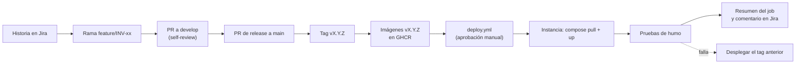

# Ruta al Avance 3 · Segunda versión y despliegue en la nube

| Campo | Valor |
| --- | --- |
| Estado | **Propuesta** del 28-oct-2026 |
| Pregunta | ¿Qué le falta a InventAI/o frente a lo que la guía de las semanas 6 a 9 espera del Avance 3, qué despliegue continuo (CD) se puede montar ya y cómo correr el componente inteligente en la nube? |
| Hechos | El Avance 3 se presenta el **viernes 30-oct**. La cuenta de AWS **no está creada**: según la propuesta aprobada, el despliegue en AWS es del Momento III (Sprints 7 a 9), y el Sprint 7 va del 2 al 21-nov |
| Fuentes | Guía «Trabajo Integrador II · Sprints semanas 6 a 9» (Univalle); propuesta aprobada del proyecto (v3, Tablas 1 y 4); Jira al 28-oct; `docs/CI-CD.md` y `docs/INV-24-requerimientos.md`; propuesta D26 en la rama `docs/propuestas-sprint-7`; precios y disponibilidad consultados el 28-oct (§5) |

## 1. Lo que pide la guía

La semana 9 es un *checkpoint*. El proyecto tiene que mostrar dos cosas:
- una **segunda versión funcional, desplegada en la nube y validada contra sus criterios de aceptación**;
- que Jira, GitHub, las pruebas y el despliegue reflejan el trabajo real de los Sprints.

| Criterio de la rúbrica | Peso | Qué se mira |
| --- | --- | --- |
| Aplicación de prácticas ágiles | 50 % | Scrum coherente; historias previstas desarrolladas; una primera versión desplegada en la nube; Product Backlog y Release Plan actualizados y justificados |
| Validación de los criterios de aceptación | 40 % | Cada historia de este momento cumple sus criterios, **con evidencia** (matriz historia → criterio → caso → esperado → obtenido → evidencia → estado) |
| Calidad de la presentación | 5 % | El estado se entiende en 15 minutos, con evidencia y una demostración organizada |

Además, la guía advierte (§5.C) que «un despliegue realizado únicamente minutos antes de la presentación» no evidencia gestión iterativa, y pide que el Release Plan «refleje la realidad» cuando la evidencia cambia el plan (§14.B). Cierra con una *Definition of Done* del periodo de 31 puntos (§17); la §3 marca los que hoy no se cumplen.

## 2. Dónde estamos (28-oct)

| Producto que pide la guía | Estado | Brecha |
| --- | --- | --- |
| Gestión de Sprints | Sprint 6 activo hasta el 1-nov, con INV-28, 30, 31, 32, 33, 35 y 36 finalizadas (INV-35 el 28-oct: merge 070e2a3, comentario de cierre 10039) | Los Sprints 5, 6 y 7 tienen el **Sprint Goal vacío**. No hay registro visible de la Review ni de la Retrospective del Sprint 6 |
| Product Backlog | Historias con criterios de aceptación y DoD en Jira | El **Sprint 7 ya tiene historias asignadas** (INV-34, 37, 40, 41, 62 y 63) antes de su Planning |
| Segunda versión | El Release 2 está en `develop`: pronóstico, recomendaciones, alertas con IA, agente de PLN y chat Vera | Corre **solo en local** |
| Validación de criterios | Cada historia tiene su documento (`docs/INV-xx-*.md`) y corridas de pantallas con capturas | La evidencia está en `evidencias/` y `resultados-*.md`, **fuera de git y sin enlace desde Jira**. No hay una matriz consolidada |
| Componente inteligente | Pronóstico (LightGBM) y agente (qwen3:8b) medidos con el conjunto v1, los holdouts y MLflow local | Falta la tabla Avance 2 → semana 9 → objetivo → decisión |
| Despliegue en la nube | CI, y publicación de imágenes en GHCR por `sha-…` y `vX.Y.Z` (INV-24) | **No hay despliegue ni cuenta de AWS.** En Jira, AWS es el Release 4 (11-dic), con INV-34 en el Sprint 7 |
| GitHub | Ramas por historia, commits descriptivos, ruleset en `main` | `develop` se integra con merge local, **sin Pull Request**; todavía no hay tag de la v2.0.0 |
| Release Plan | Releases 2 (31-oct), 3 (21-nov) y 4 (11-dic) en Jira | Las descripciones quedaron atrás. El R2 dice «Ambiente: Local» y no menciona el agente. El R3 promete «Llama + RAG NL→SQL», que se reemplazó por qwen3 con herramientas |
| Arquitectura y Smart BPM | Diagramas de la etapa de diseño | Faltan el agente, el chat por SSE y la topología de despliegue |

## 3. Puntos de quiebre

Están ordenados por impacto en la rúbrica. «DoD n» es el punto de la lista de la §17 de la guía.

| # | Punto | Por qué rompe | Qué hacer |
| --- | --- | --- | --- |
| Q1 | **No habrá versión en la nube el viernes** | El 50 % menciona «una primera versión desplegada en la nube» (DoD 21, 23 y 24). La propuesta aprobada deja AWS para después de validar el sistema (Momento III). Sin cuenta, un despliegue exprés el jueves sería el que la guía dice que no evidencia gestión iterativa | Mostrarlo como **desviación justificada** del Release Plan, con fecha y dueño: INV-34A en la primera semana del Sprint 7 (§6). Llegar al viernes con el CD listo hasta el artefacto (N1 y N2 de la §4) |
| Q2 | **El agente no es viable en la máquina de la propuesta** | La propuesta presupuesta una `c6i.2xlarge` sin GPU «para Llama cuantizado». El spike de INV-30 midió qwen3:8b en CPU: unos 4 tokens/s y 42 s por ronda, lejos del p95 ≤ 30 s | Elegir entre GPU, Bedrock o CPU con la comparación de la §5 (decisión D-R3) |
| Q3 | **Cuenta y cuotas** | Las instancias con GPU tienen **0 vCPU de cuota por defecto** en una cuenta nueva («Running On-Demand G and VT instances»), y AWS no publica un plazo para el aumento. En el plan gratuito, Bedrock puede aparecer con cuotas en 0 | Crear la cuenta el primer día del Sprint 7, pasarla al plan pago (los créditos siguen valiendo) y pedir la cuota ese mismo día |
| Q4 | **Configuración insegura para internet; el CI vuelve a fallar el 2-nov** | DoD 22. Hoy: `JWT_SECRET_KEY` con valor por defecto, CORS `*`, usuarios de prueba con `admin123`, `ml-service` sin autenticación y sin TLS. La CVE de `dnspython` se corrigió (cee3fd3), pero **las excepciones de pip-audit de ecdsa y python-jose vencen el 2-nov**: ese día el CI vuelve a fallar | Antes del 2-nov: cambiar python-jose por PyJWT, que estaba previsto y quita las dos excepciones, o renovarlas con motivo. Hardening mínimo antes de exponer (INV-41A) |
| Q5 | **La versión que corre no se puede identificar** | DoD 20. Ni `/api/health` ni la interfaz dicen qué versión corre | Inyectar la versión (tag o SHA) al construir las imágenes y mostrarla en `/api/health` y en la interfaz |
| Q6 | **Evidencia de Scrum incompleta** | DoD 1, 5, 6 y 29: Sprint Goals vacíos, Review y Retrospective sin registro visible, y un Sprint 7 lleno por adelantado | Antes del viernes: Review y Retrospective del Sprint 6 con al menos una acción de mejora; sacar del Sprint 7 lo que no salga de su Planning. No reescribir el pasado: si los objetivos del 5 y del 6 no se escribieron, decirlo en la Retrospective y escribir bien el del 7 |
| Q7 | **La validación no está enlazada** | El 40 % se juega aquí: matriz con el estado de cada criterio y evidencia accesible (DoD 11, 12 y 14). Las capturas tienen datos reales del negocio y el repositorio es público | Una matriz por historia del Release 2 en Confluence o Jira, con la evidencia adjunta allí, privada, y no en el repositorio |
| Q8 | **Pull Requests y versión** | La guía pide PR y code review «según la política definida», y un tag o release de lo desplegado (DoD 19 y 20) | Release v2.0.0 como PR de `develop` a `main`, con tag `v2.0.0`. Desde INV-34A, integrar con PR a `develop` y *self-review* con la plantilla que ya existe. Sumar al ruleset de `main` los checks del agente, que siguen pendientes |
| Q9 | **Métricas de IA sin comparación** | DoD 17 y 18: comparar con el Avance 2, contra un objetivo y con la decisión tomada | Tabla de métricas del pronóstico y del agente (acierto, herramienta correcta, fidelidad, fugas, p95): Avance 2 → semana 9 → objetivo → decisión |
| Q10 | **Arquitectura y Smart BPM desactualizados** | DoD 28 | Agregar el agente, el chat por SSE, Nginx y la topología objetivo de la §5 |
| Q11 | **El chat necesita HTTPS y conexiones largas** | Sin HTTPS no aparece el botón «Copiar» de Vera, porque el portapapeles exige un sitio seguro. El SSE y las recomendaciones en frío (20 a 42 s) se cortan detrás de CloudFront (30 s por defecto) o de un balanceador con el tiempo por omisión (60 s) | En staging: TLS en la instancia y Nginx como única puerta, con su límite de 135 s, sin CloudFront ni ALB |
| Q12 | **Sin plan B para la demostración** | DoD 31 | Stack local listo y un video corto del flujo principal con Vera |

## 4. CD que se puede hacer ya

INV-24 hizo la mitad «CI» y dejó escrito el contrato del despliegue. Se sube por niveles; cada uno sirve sin el siguiente.

| Nivel | Qué | Cuándo | Depende de |
| --- | --- | --- | --- |
| N0 | CI de calidad; imágenes escaneadas y publicadas en GHCR (`sha-…`, `develop`, `vX.Y.Z`) | ✅ Existe | — |
| N1 | **Release v2.0.0 identificable:** PR de `develop` a `main`, tag `v2.0.0`, GitHub Release con notas y enlaces a Jira. Las imágenes `v2.0.0` las publica `images.yml` sola | **Antes del viernes**, como cierre del Release 2 (31-oct) | CI verde |
| N2 | **Compose de producción** (`docker-compose.prod.yml`) con un **script de pruebas de humo**: imágenes de GHCR por `IMAGE_TAG`, sin build; solo `web` publica puertos; secretos por variables, sin valores por defecto. Se demuestra en local levantando la `v2.0.0` desde GHCR, el mismo artefacto que irá a la nube | Antes del viernes si alcanza; si no, el primer día del Sprint 7 | N1 |
| N3 | **Workflow de despliegue** (`deploy.yml`): a demanda o al publicar un tag; entorno `production` de GitHub con aprobación manual; rol de AWS por OIDC, sin claves guardadas; SSM corre `docker compose pull` y `up -d --wait` con el tag en la instancia; después, las pruebas de humo y un resumen en el job | Sprint 7 (INV-34A) | Cuenta de AWS |
| N3′ | Si OIDC se complica: **script de despliegue versionado** (`scripts/desplegar.sh`) que se corre en la instancia con el tag. La guía acepta un despliegue manual o semiautomático mientras haya trazabilidad | Sprint 7 | Cuenta de AWS |
| N4 | Microservicios en AWS (D26: ECS Fargate, RDS, CloudFront con S3) | Release 4 | Decisión D26 |

**Pruebas de humo** (las de la guía, con lo nuestro). El mismo script corre contra el local, contra staging y contra producción:

| Prueba | Cómo | Esperado |
| --- | --- | --- |
| Acceso y versión | `GET /` y `GET /api/health` | Carga la aplicación y la versión es la del tag |
| Autenticación | `POST /api/auth/login` con un usuario de humo (secreto) | Token válido |
| Datos | Una consulta de inventario y el resumen de alertas | Las cifras de la bodega al 31-dic-2025 |
| Componente inteligente | `GET /api/alertas/ml` y `GET /api/chat/health` | Responden; el agente dice `listo` con el modelo fijado |
| Error controlado | Login con clave errada; una ruta inexistente | 401; vuelta al inicio, sin trazas |

**Trazabilidad** (la cadena del ejemplo de la guía):

## 5. El componente inteligente en la nube: alternativas

El pronóstico (`ml-service`) corre en CPU sin problema. La pregunta es dónde corre el modelo de lenguaje del agente.

Datos consultados el 28-oct-2026. Los precios son bajo demanda, en us-east-1 y en dólares; hay que confirmarlos en la calculadora de AWS antes de comprometer presupuesto.

| Alternativa | Costo | Disponibilidad para una cuenta nueva | Qué implica para el proyecto |
| --- | --- | --- | --- |
| **A. EC2 con GPU y Ollama** — `g4dn.xlarge` (T4, 16 GB) | ~US$0,526/h; ~US$384/mes encendida siempre. Encendida solo en validaciones y demostraciones (~40 h al mes): ~US$21 más el disco | **Cuota 0 por defecto** para G y VT; hay que pedir el aumento (4 vCPU) y AWS no publica un plazo. La cuota de *spot* es otra y también arranca en 0 | El mismo qwen3:8b ya evaluado: las métricas siguen valiendo y solo se mide la latencia. Mantiene D22 (modelo autoalojado). Otras opciones: `g6.xlarge` (L4) ~US$0,805/h y `g5.xlarge` (A10G) ~US$1,006/h, con la misma cuota |
| **B. Amazon Bedrock** — Qwen3-32B por token | ~US$0,15 por millón de tokens de entrada y ~US$0,60 de salida. Una pregunta usa unos 3.400 de entrada y 300 de salida: **~US$0,0007**, menos de US$1 al mes para el volumen previsto | **Activo.** En us-east-1, us-east-2, us-west-2 y sa-east-1 (São Paulo), entre otras. Los modelos sin servidor quedan habilitados por defecto desde oct-2025. En el plan gratuito puede mostrar cuotas en 0: hay que pasar al plan pago | API `Converse` y Chat Completions compatible con OpenAI, con llamadas a herramientas del lado del cliente (`bedrock-mantle`). Exige un adaptador en `ClienteLLM`, **volver a evaluar** (cambia el modelo: v1 y holdouts) y aprobar D26 (los datos salen a un servicio de AWS, dentro de la cuenta). Riesgos: su ciclo de vida dice «EOL no antes del 29-abr-2026», así que puede pasar a *legacy*, y el precio viene de fuentes de terceros |
| **C. EC2 con CPU** — `c6i.2xlarge`, la de la propuesta | ~US$0,34/h; ~US$246/mes (Tabla 4 de la propuesta) | Sin cuota especial | qwen3:8b responde en más de un minuto por pregunta: no cumple el p95 ≤ 30 s y la demostración de Vera queda expuesta. Si se usa, se declara el defecto de latencia, como en el ejemplo PERF-07 de la guía |
| **D. Mixta** — EC2 pequeña sin GPU (por ejemplo, `t3.large`, ~US$0,083/h) para la aplicación, con Bedrock para el modelo | ~US$60/mes encendida siempre, más el modelo (menos de US$1) | Sin cuota especial | El esquema más barato que cumple la latencia. Tiene las mismas condiciones que B |

**Lectura:**
- **Si se mantiene D22** (modelo autoalojado), la opción es A: pedir la cuota el primer día del Sprint 7 y usar C mientras llega, con el defecto de latencia declarado.
- **Si se aprueba D26**, la opción es D: no necesita cuota, es la más barata y cumple la latencia, pero suma un adaptador y una nueva evaluación del agente en el Sprint 7.

En los dos casos, el resto del sistema es el mismo compose de N2.

**Topología de staging** (para INV-34A, con cualquiera de las alternativas):

| Pieza | Elección |
| --- | --- |
| Instancia | Una EC2 con compose: `web` (Nginx con TLS), `api`, `ml-service`, `nlp-agent`, Redis y Postgres; más Ollama en A y C |
| Datos | `pg_dump` de la bodega (454 MB) restaurado en el disco de la instancia; la base no publica puerto. RDS queda para INV-34B |
| Nombre y TLS | IP elástica con un nombre de `sslip.io` y Let's Encrypt, sin comprar dominio; Route 53 en INV-34B |
| Región | us-east-1 por precio. sa-east-1 (São Paulo) si se prefiere cercanía: cuesta más por hora y también tiene Qwen3-32B en Bedrock |

## 6. Ruta propuesta

**Hasta el viernes 30-oct (Avance 3).** Se prioriza lo que pesa en la rúbrica y lo que ya existe:

| Cuándo | Qué | Para qué punto |
| --- | --- | --- |
| Mié 28 | ✅ CI verde en cee3fd3 (corrección de `dnspython`) e INV-35 finalizada en Jira | Q4, Q6 |
| Mié 28 y jue 29 | Review y Retrospective del Sprint 6 con una acción de mejora; matriz de aceptación del Release 2; tabla de métricas de IA | Q6, Q7, Q9 |
| Jue 29 | Release Plan actualizado en Jira: descripciones de los releases, **INV-34A** con fecha y justificación; Sprint 7 sin asignaciones previas | Q1, Q6 |
| Jue 29 | PR de release, tag `v2.0.0` y GitHub Release (N1); compose de producción y pruebas de humo en local (N2), si alcanza | Q5, Q8 |
| Vie 30 | Diapositivas con la cadena de la guía y la desviación del despliegue justificada; plan B listo | Q1, Q12 |

**Primera semana del Sprint 7 (2 al 6-nov), INV-34A · primer despliegue en staging.**
- Cuenta de AWS en el plan pago, pedido de cuota, decisión D-R3 y hardening mínimo (INV-41A, con PyJWT).
- Compose de producción en la instancia, despliegue de la `v2.0.x` (N3 o N3′) y pruebas de humo.
- Casos críticos de aceptación en la nube: login, consulta, pronóstico, alertas con IA y una pregunta a Vera, con la evidencia en Jira.

**Cambios en Jira**, con la justificación de este documento:
- partir INV-34 en **INV-34A** (staging, Sprint 7) e **INV-34B** (producción: RDS, copias en S3, dominio y CloudFront, Release 4);
- partir INV-41 en **INV-41A** (hardening mínimo antes de exponer) y el resto (pruebas de carga y lo demás).

## 7. Decisiones

| # | Decisión | Estado |
| --- | --- | --- |
| D-R1 | Fecha del Avance 3 | **Viernes 30-oct** (usuario, 28-oct) |
| D-R2 | Cuenta de AWS | **Personal, se crea en el Momento III**, como dice la propuesta (usuario, 28-oct). Recomendación: plan pago desde el primer día del Sprint 7 |
| D-R3 | Dónde corre el modelo en la nube | **Abierta**, con la comparación de la §5: A si se mantiene D22, D si se aprueba D26 |
| D-R4 | Base de datos en staging | Propuesta: Postgres en la instancia; RDS en INV-34B |
| D-R5 | Mecanismo de CD | Propuesta: N3 (OIDC y SSM); N3′ si OIDC se complica |
| D-R6 | Nombre y TLS | Propuesta: `sslip.io` con Let's Encrypt para staging |
| D-R7 | Replanificación en Jira | Propuesta: INV-34A/34B e INV-41A, y descripciones de los releases al día |

## Fuentes de la §5

- Bedrock, ficha de Qwen3-32B (estado, APIs, herramientas y regiones): https://docs.aws.amazon.com/bedrock/latest/userguide/model-card-qwen-qwen3-32b.html
- Bedrock, habilitación automática de los modelos sin servidor (15-oct-2025): https://aws.amazon.com/about-aws/whats-new/2025/10/amazon-bedrock-automatic-enablement-serverless-foundation-models
- Bedrock en el plan gratuito con cuotas en 0: https://repost.aws/questions/QUrHqBJPLQRqaz6OH-I8RtOg/free-plan-bedrock-has-zero-quotas
- Precio de Qwen3-32B en Bedrock (terceros): https://custom.typingmind.com/tools/estimate-llm-usage-costs/amazon-bedrock/qwen-qwen3-32b-v1-0 y https://aws-bedrock-explorer.com/models/qwen
- Cuotas de EC2 por tipo de instancia (G y VT en 0 por defecto): https://docs.aws.amazon.com/ec2/latest/instancetypes/ec2-instance-quotas.html
- Precios de EC2: https://www.doit.com/compute/compute/aws/us-east-1/g4dn.xlarge, https://www.devzero.io/instances/aws/g6.xlarge y https://www.devzero.io/instances/aws/g5.xlarge
- Plan gratuito de AWS en 2026 (créditos y restricciones): https://builder.aws.com/content/3Iv9tJEEumjb9aFubl1zmd53SlP/the-aws-free-tier-changed-what-every-new-account-gets-in-2026-and-the-five-things-to-set-up-on-day-one
