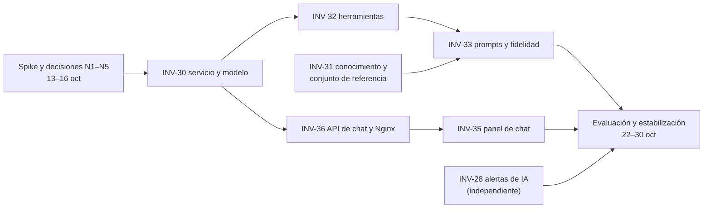

# Sprint 6 · Requerimientos enriquecidos de las HUs para el Release 2

> **Estado de este documento (16-oct-2026).** Es la fuente de las fichas de INV-28 y de INV-30 a INV-36 que se reescribieron en Jira el 15-oct, y de las decisiones N1 a N9. Se versiona tal como se escribió; las decisiones posteriores no cambian el texto, se anotan aquí:
>
> - **INV-28 (secciones 6 y 7) está superada.** Lo que se implementó y verificó, con la conciliación V14 frente a esta ficha, está en [`INV-28-requerimientos.md`](INV-28-requerimientos.md) y [`INV-28-alertas-ml.md`](INV-28-alertas-ml.md). La historia se Finalizó el 15-oct.
> - **Pendientes de la sección 12 resueltos por el usuario el 15-oct:**
>   - n.º 4: la etiqueta es `v2.0.0`;
>   - n.º 5: Ollama nativo en WSL y el contenedor del perfil `llm` como segundo modo;
>   - n.º 6: las metas de 85 %, 95 %, cero fugas y p95 ≤ 30 s.
>
>   Siguen abiertos el n.º 7 y el n.º 9.
> - **Ajustes a N2, N5 y N8** (decisiones W1 a W13 en [`INV-30-requerimientos.md`](INV-30-requerimientos.md)):
>   - el spike de Qwen3 corre completo sin razonamiento y, con razonamiento, solo mide la latencia en 5 preguntas;
>   - el cliente usa la API nativa de Ollama detrás de una interfaz intercambiable, y el adaptador compatible con OpenAI queda para INV-34 si hace falta.
> - **El texto llegó cortado en la sección 14** por el límite del chat. Las filas que siguen a `frontend/nginx.conf` se completaron desde las secciones 7 y 8 y van marcadas con *(reconstruida)*.

Borrador del 2026-10-13, pendiente de confirmación antes de reescribir Jira. Se escribió contra `develop` (commit `44fc71b`), las descripciones actuales de Jira, las decisiones D1 a D21 y A1 a A6 de «Modelos y decisiones técnicas», la revisión técnica del 7 de octubre y el estado del Release 2 (fecha de lanzamiento: **31 de octubre de 2026**).

**Actualización del 14 de octubre.** Decisión D22: el modelo de lenguaje es **autoalojado**; no se usan APIs externas de LLM (la aplicación es de uso interno). Cambian N2, el spike, el cronograma, los criterios de INV-30, INV-32 e INV-33 y los riesgos; se agregan N8 y la medición en AWS.

**Alcance del despliegue (14 de octubre).** El Release 2 se monta **en local** como prerrequisito, y el diseño debe permitir migrar después a la cuenta de AWS propia (INV-34, Release 4) sin rehacer nada. La migración en sí no entra en el Sprint 6; sí entra dejarla preparada (sección 8.1).

**Colab (14 de octubre).** Hay créditos de Colab disponibles para esta etapa de planeación. Se usan solo para el spike y la evaluación, **con datos sintéticos** y con un arnés que corre sin Docker (N9). No sirven el release: este corre en local.

Convención: cada criterio de aceptación lleva una prioridad: **(M)** debe estar en el release, **(S)** conviene que esté, **(C)** puede pasar al Release 3.

## 1. Resumen

**Objetivo del release.** «Predictivo y Conversacional v1»: el 31 de octubre un gerente, un administrador de bodega y un administrador de sucursal deben poder, desde la aplicación y con el sistema corriendo en local, **conversar en español con un agente** que consulta el inventario, las alertas, los pronósticos y las recomendaciones respetando sus permisos, y ver las **alertas de IA** junto a las de reglas.

**Dónde estamos.** Del Release 2 están hechas 17 de 24 historias (101 de 145 SP). Quedan las 7 de este sprint, 44 SP, y **del agente no existe nada en `develop`**: ni servicio, ni Ollama en el compose, ni endpoint de chat, ni cliente de streaming. INV-28 e INV-30 figuran «En curso» en Jira, pero no hay ramas ni commits.

**Tiempo.** Del 13 al 30 de octubre hay **14 días hábiles**. Entregar 44 SP exige 3,1 SP por día; en los tres últimos sprints se rindió a unos 3,4. Es viable solo sin holgura y sin retrabajo.

**Lo que encontré al contrastar las historias con la realidad**

| Hallazgo | Evidencia | Consecuencia |
| --- | --- | --- |
| Las 7 historias son el borrador original: 4 criterios cada una y DoD genérico | Descripciones de Jira | Hay que reescribirlas, como se hizo con INV-21 a 27 |
| INV-31 (NL → SQL) contradice la regla de permisos | D12 y D13: los permisos viven solo en el Core API; un SQL generado contra `dw.*` los salta (revisión técnica, A1) | Reencuadrar INV-31 (sección 7) |
| INV-30 pide «Llama 3»; Ollama soporta herramientas desde Llama 3.1 | Anuncio de Ollama de julio de 2024 y guías de 2026; el propio `ml_service` habla de «Llama 3.1» | El modelo se fija con un spike y se verifica que soporte herramientas (N2) |
| INV-36 enruta `/api/chat/` de Nginx directo al agente | Criterio 2 de INV-36 y comentario de `frontend/nginx.conf` | Saltaría el JWT y los permisos: el chat debe pasar por el Core API (N3) |
| INV-36 menciona WebSocket | El navegador no puede poner el encabezado `Authorization` en un WebSocket | SSE sobre `fetch` (N4) |
| INV-32 invoca el «ML Service» | D12: `ml_service` es interno y sin autenticación | Las herramientas llaman solo al Core API, incluido `/api/ml/*` |
| INV-28 no define umbrales, fuente ni cómo convive con las alertas por reglas | `app.config_alertas` existe pero ningún código la usa; hay 585 líneas urgentes y 255 altas en compras | Definir tipos, fuente y calibración (sección 7) |
| Las respuestas hablarían de «hoy» | El inventario es una foto del 31-dic-2025 | El agente debe decir siempre la fecha del dato (INV-33) |

## 2. Qué significa «Release 2 listo»

| # | Criterio de release | Cómo se verifica |
| --- | --- | --- |
| R1 | Los 3 roles chatean y reciben respuestas correctas y limitadas a sus permisos | Conjunto de referencia (≥ 40 preguntas, congelado) y pruebas de fuga entre roles y sucursales |
| R2 | Las alertas de IA se ven en la página de Alertas con su insignia | Guía de pantallas con los 3 roles |
| R3 | `docker compose` levanta el sistema completo (perfil `llm` para el modelo) **desde cero**, en CPU como mínimo y con GPU si está disponible, y está documentado | Corrida limpia siguiendo `docs/`, una vez con GPU y otra sin ella |
| R4 | CI en verde con la imagen del agente, pruebas y umbrales | Checks del PR a `develop` y a `main` |
| R5 | Documentación al día: un documento por historia, decisiones, dossier y retrospectiva | Lista de la sección 9 |
| R6 | El agente es de solo lectura, no se publica fuera de la red interna y no guarda el texto de las conversaciones | Pruebas y revisión de configuración |
| R7 | Etiqueta de versión del release | Pendiente: número de versión (`v1.1.0` o `v2.0.0`) |
| R8 | Listo para migrar: se cumplen los puntos «Debe estar» de la sección 8.1 | Lista de verificación de la sección 8.1 |

## 3. Estado de `develop` frente a cada historia (verificado)

| Pieza | Existe | Falta |
| --- | --- | --- |
| Core API | 23 endpoints homologados, más `/api/ml/predict` y `/api/ml/recomendaciones/*`, con permisos por ubicación y formatos es-CO | Router de chat; endpoint de alertas de IA |
| ML Service | Pronóstico, compras y traslados; `interpretacion.py` genera texto por reglas | Nada nuevo; sigue siendo interno |
| Alertas | 5 tipos por reglas, umbrales en código (3 y 7 días), `AlertaItem` con paginación | Alertas de IA, campo `origen`, calibración |
| Datos para alertas de IA | Cada fila del balance trae `estado`, `urgencia`, `dias_hasta_agotarse`, `excedente`, `excedente_sin_destino`, `maximo`, `deficit_neto`; la caché del Core API guarda el balance completo | Un adaptador de balance a alertas |
| Agente | **Nada** | Servicio, modelo, herramientas, prompts, evaluación |
| Frontend | `RUTAS`, `useConsulta`, estados, formato, utilidades de prueba, Vitest con umbral de 80 %; Layout con menú lateral, cabecera y `main` | Cliente de streaming, panel de chat, renderizado de datos estructurados |
| Nginx | `/api/` hacia el Core API con 135 s | Ubicación de streaming sin buffer |
| Compose | `postgres`, `redis`, `api`, `ml-service`, `web`, `pgadmin`; Docker Desktop con WSL2 | `ollama` y `nlp-agent`; ninguna nota sobre GPU |
| CI | `images.yml` tiene una lista de servicios con una fila por servicio nuevo; `.coveragerc` por servicio | Fila de `nlp-agent`, umbral, marca de pruebas con LLM real |
| Pruebas | `MLFalso` (httpx) para el Core API; `renderConUsuario` y `simularApi` para el frontend | Doble del LLM; doble del agente; mock de streaming |

## 4. Decisiones que hay que cerrar en los primeros tres días

| Código | Decisión | Recomendación | Evidencia que la sostiene | Afecta |
| --- | --- | --- | --- | --- |
| N1 | Arquitectura del agente (A1) | **Herramientas de solo lectura sobre el Core API**; NL → SQL queda fuera del release | D12 y D13; revisión técnica §3.1; sin base de datos en el agente no hay fuga posible | INV-31, 32, 33 |
| N2 | Modelo (A2) | **Spike de dos días** con tres candidatos autoalojados que soporten herramientas: `qwen3:8b` en Q4_K_M (con razonamiento activado y desactivado), `llama3.1:8b` (línea base) y `Qwen3-4B-Instruct-2507` (sin modo de razonamiento) para el perfil de CPU, con el conjunto de referencia v0; variantes Q5 o Q6 si la memoria alcanza; diseño estadístico y referencias en la sección 5.1 | Llama 3 original no trae herramientas; 8 GB de VRAM limitan modelo y contexto; en CPU lo que más pesa es la **velocidad de procesamiento del prompt**, no solo los tokens por segundo. Qwen3-8B es híbrido (razonamiento por defecto) y una fuente de terceros reporta dos fallas con Ollama: el razonamiento que se filtra al texto con `think: false` y los argumentos de lista devueltos como texto JSON; el 4B Instruct-2507 no tiene modo de razonamiento | INV-30, 33 |
| N3 | Ruta del chat | Navegador → Nginx → **Core API `/api/chat`** → agente interno → herramientas con el JWT del usuario | D12 (una sola puerta) | INV-35, 36 |
| N4 | Transporte | **SSE sobre `fetch`**, no WebSocket | El JWT va en un encabezado, que el WebSocket del navegador no permite; es un flujo en un solo sentido | INV-35, 36 |
| N5 | Capa de herramientas | **Bucle propio** sobre la API de Ollama (compatible con OpenAI) con esquemas Pydantic, en vez de LangChain | Menos dependencias que auditar y actualizar; control del bucle, los límites y los errores. Si se quiere LangChain, limitarlo a `langchain-core` | INV-32 |
| N6 | Dónde corre el modelo en desarrollo | Dos modos por `OLLAMA_BASE_URL`: Ollama en el equipo (con la GPU) o contenedor `ollama` con el perfil `llm` | No se sabe si la GPU se expone bien a Docker Desktop con WSL2 | INV-30 |
| N7 | Alcance de v1 | Los niveles de la sección 6 | 41–66 SP de trabajo real frente a ~48 SP de capacidad (sección 10) | Todas |
| N8 | Proveedor del LLM (D22) | **Autoalojado, sin APIs externas.** Cliente compatible con OpenAI con la dirección en `LLM_BASE_URL`; sin perfil de API. El presupuesto de tokens por ronda es requisito de diseño | La aplicación es de uso interno; los datos del negocio no salen a terceros (D19, D22) | INV-30, 32, 33 |
| N9 | Uso de Colab | **Solo para el spike y la evaluación, con datos sintéticos**; nunca con la bodega real, y no para servir el release. El arnés (`scripts/` o un cuaderno) corre sin Docker contra cualquier `LLM_BASE_URL`, fija la versión de Ollama y el digest del modelo y guarda sus resultados en el repositorio | Colab es un entorno temporal de un tercero: la regla de D22 (los datos del negocio no salen) se mantiene; sin Docker, el arnés no puede depender del compose | INV-30, 31 |

## 5. Ruta crítica y cronograma

| Fechas | Días | Pista A: agente | Pista B: API y UI del chat | Pista C: alertas |
| --- | --- | --- | --- | --- |
| 13–16 oct | 1 a 4 | Spike del modelo; INV-30 (servicio, `/health`, `/ready`, compose); conjunto de referencia v0 | Contrato SSE y esqueleto del endpoint con un agente de mentira | INV-28: adaptador y calibración con la bodega real |
| 19–21 oct | 5 a 7 | INV-32: herramientas (las 6 primeras) | INV-36: Core API, Nginx, concurrencia | INV-28: endpoint y pruebas |
| **21 oct** | | **Punto de control: «hola extremo a extremo»**: una pregunta pasa por herramienta y vuelve en streaming con los 3 roles | | |
| 22–27 oct | 8 a 13 | INV-32 (resto), INV-33, INV-31 (RAG acotado), evaluación | INV-35: panel, streaming, datos estructurados | INV-28: interfaz y pruebas |
| 28 oct | 14 | **Congelamiento de código** | | |
| 29–30 oct | | Regresión local (integración, Postman, guía de pantallas), documentación, dossier y decisiones | | |
| 31 oct | | Etiqueta y lanzamiento | | |

**Reglas de corte**
- Si el 21 de octubre no hay «hola extremo a extremo», INV-31 pasa al Release 3 y se recorta el catálogo a 6 herramientas.
- Si el 27 de octubre la latencia p95 del modelo elegido supera 30 s en el equipo de desarrollo, se baja a un modelo menor o se desactiva el razonamiento extendido.
- Si INV-35 va atrasada, se entrega el panel sin chips ni pulido móvil, pero con streaming, datos estructurados y permisos.
- Si INV-28 va atrasada, se entrega el tipo `riesgo_desabastecimiento` y `sobrestock_previsto` pasa al Release 3.

**Medición de GPU en Colab.** Si tu plan ofrece una GPU L4 (la misma de la `g6.xlarge` de AWS), el spike puede medir allí el perfil de «GPU por ventanas» de A7 y sumar modelos que no caben en tus 8 GB (`qwen3:14b` y `Qwen3-30B-A3B-Instruct-2507`) como techo autoalojado, para dimensionar cuánta calidad se pierde al bajar de tamaño. Una T4 sirve para modelos de hasta 8B pero no representa la L4. Colab no representa ni tu equipo (la latencia del Release 2 se mide en él) ni la CPU de AWS.

**Medición en AWS (19–20 oct) y cuota.** Hoy mismo, pedir en AWS el aumento de cuota de instancias con GPU (en cuentas nuevas el límite suele ser 0 y la aprobación puede tardar). El 19 y 20, con las mismas preguntas del spike: una `c6i.2xlarge` (CPU, la presupuestada) de 2 a 3 horas, unos US$1, con el perfil de prompt corto; y una `g6.xlarge` (GPU de 24 GB) de 1 a 2 horas, unos US$1 a 2, con el modelo del spike y uno de 12 a 14B como techo de calidad entre los modelos autoalojados. Con eso se decide el perfil de producción (A7) antes de INV-34. **Como el Release 2 es local, esta medición es (S):** si el 21 de octubre no hay «hola extremo a extremo», pasa al primer día del Sprint 7. Con Colab para la GPU, la solicitud de cuota de AWS deja de ser urgente, y la medición en AWS se reduce a la CPU de la `c6i.2xlarge` (unos US$1).

### 5.1 Diseño del spike y su base

Es un **spike técnico**: una prueba mínima y acotada en el tiempo (15 y 16 de octubre) para reducir un riesgo antes de construir (el término viene de Extreme Programming, atribuido a Kent Beck).

**Diseño**
- Examen v0 de 20 preguntas para los tres roles, con **al menos 4 donde la respuesta correcta es no llamar a ninguna herramienta** (abstención).
- Cada pregunta se corre **3 veces** por candidato, con el mismo prompt, contexto y ajustes.
- Medidas: herramienta y argumentos correctos (promedio y **pass^3**, es decir, que las 3 corridas acierten), fidelidad de cifras, fallas de formato, tiempos (primer token, total, p95), velocidad de lectura del prompt, tokens por ronda y memoria.
- Comparación entre candidatos: **diferencias pareadas por pregunta con su intervalo** (bootstrap pareado o error estándar). La regla de empate de 10 puntos queda solo como criterio práctico: si los intervalos no separan a dos candidatos, se decide por tamaño y latencia.
- Metas propuestas, sin aprobar: herramientas correctas ≥ 85 %, fidelidad ≥ 95 % y p95 ≤ 30 s en el equipo de desarrollo.
- Límite: con 20 preguntas el intervalo será ancho. El spike orienta; no certifica. La evaluación completa es INV-31 (al menos 40 preguntas).

**Referencias** (verificadas el 14 de octubre de 2026: títulos, autores y resúmenes; no los textos completos)

| Qué respalda | Referencia |
| --- | --- |
| El concepto de spike | Wiki de C2, «Spike Solution» (https://c2.com/xp/SpikeSolution.html); Wikipedia, «Spike (software development)»; Scrum Alliance, «Spikes in Scrum: the exception, not the rule» (copia en web.archive.org) |
| Evaluar llamadas a herramientas, incluida la abstención, la latencia y el costo | Patil et al., «The Berkeley Function Calling Leaderboard (BFCL)», ICML 2025 (https://proceedings.mlr.press/v267/patil25a.html) |
| Repetir y medir la consistencia (pass^k) | Yao et al., «τ-bench», arXiv 2406.12045, ICLR 2025 (https://arxiv.org/abs/2406.12045) |
| Error estándar y diferencias pareadas con pocas preguntas | Miller, «Adding Error Bars to Evals», arXiv 2411.00640 (https://arxiv.org/abs/2411.00640); su autor trabaja en Anthropic |

**Diseño propio, no publicado:** el tamaño (20 preguntas y 3 corridas), la regla de empate, las metas y el chequeo de fidelidad de cifras. Las comparaciones previas entre Qwen3 y Llama 3.1 vienen de sitios de reseñas, no de una fuente oficial.

## 6. Alcance por niveles

| Nivel | Qué incluye |
| --- | --- |
| **Debe estar** | Arranque local desde cero, en CPU como mínimo, y preparación para migrar (sección 8.1); INV-30 (servicio y modelo medido); INV-32 (6 a 10 herramientas de solo lectura); INV-33 (prompts por rol, fidelidad, multi-turno, marco temporal); INV-36 (chat por el Core API con SSE, concurrencia y Nginx); INV-35 (panel con streaming, estados, datos estructurados y fuentes); INV-28 (`riesgo_desabastecimiento` en la página de Alertas); imagen del agente en el CI; documentación |
| **Conviene** | INV-31 como RAG acotado con el glosario y el conjunto de referencia; `sobrestock_previsto`; chips por rol; registro de llamadas a herramientas |
| **Puede pasar al R3** | NL → SQL; historial persistente (INV-37); refinamiento del agente (INV-40); streaming de llamadas a herramientas; tarjeta de IA en el Dashboard; WebSocket |

## 7. Enriquecimiento por historia

### INV-30 · NLP Agent Service (5 SP, En curso)

**Brechas.** «Llama 3» no soporta herramientas (hace falta 3.1 o posterior u otro modelo con soporte); «Ollama funcional» no distingue GPU de CPU; no hay criterio de salud que separe «el servicio vive» de «el modelo está listo»; no se define cómo se construye, escanea y publica la imagen.

**Limitaciones.** 8 GB de VRAM: un modelo de 8B cuantizado ocupa unos 5–6 GB y el contexto (`num_ctx`) no puede crecer sin límite. La instancia de AWS presupuestada es solo CPU. La descarga del modelo pesa varios GB.

**Deuda a evitar.** Dependencias de producción y de desarrollo mezcladas; un puerto de Ollama publicado; pruebas que requieren el modelo real dentro del CI.

**Criterios de aceptación**
1. (M) Servicio `nlp_agent/` (FastAPI, :8002) con Dockerfile de producción como las demás imágenes: usuario sin privilegios, `HEALTHCHECK`, sin `--reload`.
2. (M) `/health` (vivo) y `/ready` (Ollama alcanzable y modelo disponible). El CI de imágenes verifica solo `/health`.
3. (M) Modelo autoalojado con soporte de herramientas y tag fijo, elegido con el spike (N2). El documento registra latencia al primer token, tokens por segundo, **velocidad de procesamiento del prompt** y memoria usada, en GPU y en solo CPU.
4. (M) Ollama accesible por `OLLAMA_BASE_URL`, desde el equipo o desde un contenedor `ollama` del perfil `llm` del compose (volumen para los modelos, reserva de GPU opcional). El puerto 11434 no se publica.
5. (M) `num_ctx`, `keep_alive` y concurrencia (`OLLAMA_NUM_PARALLEL=1`) se fijan por configuración y quedan documentados.
6. (M) El servicio no tiene credenciales propias hacia la bodega ni hacia el Core API: actúa con el token del usuario (INV-32).
7. (M) La imagen entra a la lista de servicios de `images.yml` y a su `.coveragerc` con umbral; ruff, `pip-audit` y Dependabot cubren `nlp_agent/`.
8. (M) `scripts/smoke_llm.py` y el arnés de evaluación corren **sin Docker** (también en Colab) contra cualquier `LLM_BASE_URL`, fijan la versión de Ollama y el digest del modelo, reproducen las mediciones del criterio 3 y **registran las 3 corridas por pregunta**, calculando el promedio, pass^3 y las diferencias pareadas por pregunta entre candidatos con su intervalo (bootstrap pareado).
9. (M) El sistema funciona **sin GPU** (más lento) y usa la GPU si el modelo corre en el equipo; los dos modos quedan documentados, para que la demostración no dependa de que la GPU esté visible para Docker (N6).

**Pruebas.** Unitarias con un Ollama simulado (`httpx.MockTransport`): configuración, cliente, `/health` y `/ready`. Una prueba de contrato de la forma de la llamada con herramientas. La marca nueva `llm` agrupa las pruebas con el modelo real: se corren solo en local y quedan en la lista de «pruebas solo locales».

**DoD específico.** «Ollama responde inferencias» se reemplaza por las mediciones del criterio 3 documentadas; compose levanta con y sin el perfil `llm`.

**Riesgos.** GPU no visible desde Docker Desktop con WSL2 (mitigación: modo Ollama en el equipo, N6); primera carga lenta del modelo; el modelo elegido en el spike no rinde en la instancia de CPU de AWS (se documenta para INV-34).

### INV-31 · RAG sobre la bodega (8 SP) → propuesta: «Conocimiento del agente y conjunto de referencia»

**Brechas.** El criterio 1 pide traducir preguntas a SQL y consultar la bodega: **salta la regla de permisos**, exige un rol de solo lectura, validar el SQL y filtrar por sucursal en la base. «10+ consultas correctas» no dice contra qué. Es la historia más riesgosa del sprint para el tiempo que hay.

**Propuesta.** Reencuadrarla en dos entregables que sí aportan al release: (a) un **RAG acotado** sobre definiciones y políticas, y (b) el **conjunto de referencia** con el que se mide todo el agente. NL → SQL pasa al Release 3 y, si se retoma, exigirá: rol de base de datos de solo lectura con vistas autorizadas, filtro por sucursal aplicado en la base, validación sintáctica del SQL, tiempo y filas máximos, y registro de cada consulta.

**Criterios de aceptación**
1. (M) Corpus en fragmentos con identificador y fuente: un **glosario de negocio** nuevo en lenguaje no técnico (`docs/GLOSARIO-NEGOCIO.md`: semáforo, cobertura, punto de pedido, calendario de pedidos, Bodega Central, perecedero, foto de inventario), `docs/GLOSARIO.md` y las políticas y reglas de INV-21 e INV-22.
2. (M) Recuperación léxica (BM25) de los k mejores fragmentos con su fuente. Sin embeddings en v1: no consumen la memoria que necesita el modelo. Se documenta cómo agregarlos.
3. (M) La herramienta `buscar_en_glosario` devuelve fragmentos con su fuente, y la respuesta la cita.
4. (M) Una pregunta fuera del corpus recibe «no tengo esa información» en vez de una invención.
5. (M) El agente no accede a la base de datos ni genera SQL.
6. (M) **Conjunto de referencia v1**: al menos 40 preguntas para los tres roles, que cubren cada herramienta, definiciones, ambigüedad y casos adversariales (otra sucursal, otro rol, instrucciones dentro de datos), y **al menos el 10 % donde la respuesta correcta es no llamar a ninguna herramienta** (abstención). La versión v0 del spike tiene 20 preguntas, con al menos 4 de abstención. Cada una con herramienta esperada (o ninguna), argumentos y hechos clave. Se congela y se versiona antes de comparar modelos.
7. (S) hit@3 de al menos 0,8 en las preguntas de definiciones.
8. (M) El índice se reconstruye igual desde el mismo corpus.
9. (C) NL → SQL como respaldo.
10. (M) El conjunto de referencia tiene una versión con **resultados de herramientas sintéticos** (sin nombres, cantidades ni fechas reales) apta para entornos externos como Colab, y una versión con datos reales que solo se corre en local.
11. (M) El informe de evaluación compara candidatos con **diferencias pareadas por pregunta y su intervalo**, reporta **pass^3** además del promedio y cita el diseño (Beck, BFCL, τ-bench, Miller) en `docs/PLN-conjunto-referencia.*`. Con 20 preguntas el intervalo es ancho: si dos candidatos no se separan, se decide por tamaño y latencia.

**Pruebas.** Fragmentado y recuperación sobre casos fijos; conjunto de referencia validado por esquema (cada pregunta con su herramienta esperada existente en el catálogo).

**DoD específico.** El conjunto de referencia queda en el repositorio antes de la comparación de modelos y se usa sin cambios en INV-32 e INV-33.

**Riesgos.** El glosario actual es sobre pronóstico, no sobre negocio: el glosario nuevo es trabajo real. 8 SP pueden sobrar si se reencuadra; se mantienen mientras no se decida lo contrario.

### INV-32 · Tool-calling (8 SP)

**Brechas.** No hay catálogo de herramientas; «invocar ML Service» contradice D12; «LangChain tools» es una decisión de dependencia sin evidencia (N5); no se define cómo se pasa el permiso del usuario, cómo se convierten nombres en ids, cómo se limita el tamaño de lo que entra al contexto (compras sin filtros trae 1.340 líneas) ni qué pasa con la primera consulta de recomendaciones, que tarda de 20 a 40 s.

**Limitaciones.** Un modelo de 8B se equivoca más al elegir entre muchas herramientas: el catálogo se limita a 10 y con descripciones breves. Ollama puede no transmitir llamadas a herramientas en streaming: el ciclo de herramientas va sin streaming y solo la respuesta final se transmite (C).

**Catálogo propuesto v1** (todas de solo lectura, todas contra el Core API)

| Herramienta | Endpoint | Nivel |
| --- | --- | --- |
| `buscar_producto(texto)` | `GET /api/consulta/productos` | M |
| `listar_sucursales()` | `GET /api/consulta/sucursales` | M |
| `consultar_inventario(sucursal, categoria, estado)` y `detalle_inventario(producto, sucursal)` | `GET /api/consulta/inventario` y `/detalle` | M |
| `listar_alertas(tipo, sucursal, origen)` y `resumen_alertas(sucursal)` | `GET /api/alertas` y `/resumen` | M |
| `pronosticar_demanda(producto, sucursal)` | `POST /api/ml/predict` | M |
| `recomendar_compras(sucursal, categoria, urgencia)` | `GET /api/ml/recomendaciones/compras` | M |
| `recomendar_traslados(sucursal, categoria, urgencia)` | `GET /api/ml/recomendaciones/transferencias` | S |
| `kpis_y_ventas(sucursal, periodo)` | `GET /api/reportes/kpis` y `/ventas` | S |
| `historial_ventas(producto, sucursal)` | `GET /api/consulta/productos/{id}/ventas` | S |
| `buscar_en_glosario(consulta)` | INV-31 | S |

**Criterios de aceptación**
1. (M) Catálogo de a lo sumo 10 herramientas de solo lectura, cada una con nombre, descripción en español y esquema de parámetros validado.
2. (M) Cada herramienta llama a un endpoint del Core API con el token del usuario. Ninguna llama a `ml_service` ni a una URL armada por el modelo.
3. (M) Los nombres se resuelven a ids con `buscar_producto` y `listar_sucursales`; si hay varios candidatos, el agente pide aclaración.
4. (M) La salida es compacta: a lo sumo 10 filas, cantidades con su unidad (misma regla `texto_cantidad`), fecha del dato y total real; nunca se vuelca una lista completa al contexto.
5. (M) Los errores del Core API (401, 403, 404, 422, 5xx y tiempo agotado) se convierten en resultados de herramienta que el modelo explica. Con un 403, no inventa.
6. (M) Máximo 3 rondas de herramientas por pregunta y un tiempo total acotado.
7. (M) Los parámetros de las herramientas coinciden con el OpenAPI versionado: una prueba de contrato en el CI falla si el Core API cambia y las herramientas no.
8. (M) Los resultados de las herramientas se tratan como datos: van delimitados y el prompt prohíbe obedecer instrucciones que vengan dentro (nombres de producto, por ejemplo).
9. (S) Registro de cada llamada: herramienta, estado y milisegundos, sin datos personales.
10. (M) Medición sobre el conjunto de referencia: herramienta y argumentos correctos en al menos el 85 % (promedio de 3 corridas, meta propuesta), con **pass^3** reportado, y **cero fugas** de permisos; si se comparan modelos, con diferencias pareadas por pregunta y su intervalo.
11. (C) Streaming de llamadas a herramientas.
12. (M) **Presupuesto de tokens por ronda** (D22): sistema, herramientas, historial y resultados caben en la meta que fije el spike (referencia para el perfil de CPU: alrededor de 3.000 tokens por ronda); se mide y se registra en cada respuesta. Descripciones de herramientas breves y salidas compactas.
13. (M) **Argumentos y razonamiento tolerantes**: los parámetros que el modelo devuelva como texto JSON (por ejemplo, una lista) se convierten antes de validar; un argumento inválido se rechaza con un mensaje que el modelo pueda corregir, una sola vez; el texto de razonamiento (`<think>`) nunca llega al usuario ni cuenta como respuesta.

**Pruebas.** Cada herramienta con un Core API simulado (`MockTransport`); prueba de contrato con el OpenAPI; pruebas adversariales (`admin_sucursal` pregunta por otra sucursal, resultado con instrucciones embebidas, bucle de herramientas); el conjunto de referencia en local.

**DoD específico.** «Tools invocados correctamente» se mide con el criterio 10 y el informe queda en `docs/`.

**Riesgos.** Precisión del modelo al elegir herramientas; latencia acumulada (modelo más herramientas); que la primera llamada de recomendaciones agote el tiempo del agente (se documenta el aviso al usuario y la caché caliente).

**Deuda.** La definición de herramientas parte del OpenAPI pero es en parte manual.

### INV-33 · System prompts y flujo conversacional (5 SP)

**Brechas.** «Probados con 3 roles» no dice cómo; no hay protección contra cifras inventadas; no se define el multi-turno bajo un contexto de pocos miles de tokens; no se trata el marco temporal (el dato es de diciembre de 2025); no hay política de rechazos.

**Criterios de aceptación**
1. (M) System prompt versionado en `nlp_agent/prompts/v1/`, con una parte común y una por rol (gerente, administrador de bodega y de sucursal), con la sucursal del usuario inyectada.
2. (M) Respuestas en español de Colombia, con el formato es-CO y las unidades correctas.
3. (M) Contexto de negocio: Bodega Central solo origen, calendario de pedidos, perecederos y frío. **Marco temporal:** toda respuesta con datos dice la fecha de la foto de inventario y nunca presenta «hoy» como la fecha real.
4. (M) **Verificación de fidelidad:** los números de la respuesta deben aparecer en los resultados de las herramientas o en la pregunta. Si no, un reintento; si falla, una respuesta de respaldo determinista con los datos de las herramientas, marcada como tal.
5. (M) Multi-turno: el cliente envía los últimos 6 turnos y el agente los recorta por presupuesto de tokens. Sin persistencia en el Release 2.
6. (M) Rechazos: fuera de alcance, sin datos, sin permiso, preguntas sobre otros usuarios. No revela el prompt.
7. (S) Sugerencias de seguimiento según la herramienta usada.
8. (M) Pruebas para los tres roles con el LLM simulado y con el conjunto de referencia en local. Metas propuestas: fidelidad de al menos 95 % y cero fugas entre roles y sucursales.
9. (M) Cada respuesta lleva la versión del prompt y del modelo.
10. (M) Perfil de prompt corto para CPU: el prompt del sistema y el recorte del historial se ajustan al presupuesto de tokens de INV-32 y se comparan contra el prompt completo con el conjunto de referencia, para saber cuánta calidad cuesta el recorte.
11. (S) Interruptor de razonamiento por configuración para modelos híbridos (`/no_think` en el prompt o parámetro del servidor); el spike decide el valor, y la temperatura y el muestreo se fijan para las llamadas a herramientas.

**Pruebas.** Instantáneas de los prompts por rol; verificador de fidelidad con casos de formato (`3.366` frente a `3366`, kilos con decimales); recorte del historial; rechazos.

**DoD específico.** «Prompts probados con 3 roles» = metas del criterio 8 cumplidas sobre el conjunto de referencia, con el informe versionado.

**Riesgos.** Calidad del español en un modelo de 8B; falsos positivos del verificador por formatos de número; prompts largos que consumen contexto.

### INV-36 · API del agente y Nginx (5 SP)

**Brechas.** El criterio 2 enruta Nginx directo al agente, sin JWT ni permisos; WebSocket no puede llevar el encabezado `Authorization`; no hay control de concurrencia (un modelo local atiende pocas peticiones a la vez: un flujo sin límite es una forma de dejar el sistema sin servicio); no se define el contrato de eventos, la cancelación ni los errores; Nginx hoy no está preparado para streaming.

**Criterios de aceptación**
1. (M) `POST /api/chat/message` en el Core API: JWT obligatorio para los 3 roles; respuesta SSE (`text/event-stream`) con los eventos `meta`, `tool`, `token`, `data`, `done` y `error`; contrato documentado en el OpenAPI.
2. (M) El Core API reenvía al agente (interno) con `Authorization` y `X-Request-Id`, y cancela aguas arriba si el cliente se desconecta.
3. (M) Un solo flujo activo por usuario y un límite global configurable (1 o 2 por defecto): al excederlo, 429 con `Retry-After` o un evento de cola.
4. (M) Tiempo total máximo configurable (por ejemplo, 120 s) con el contrato de errores del Core API.
5. (M) Nginx: ubicación `/api/chat/` con `proxy_buffering off`, sin compresión para `text/event-stream` y tiempos propios; la API envía `X-Accel-Buffering: no`. Un script `scripts/probar_nginx_streaming.sh` (como el de tiempos) comprueba que los fragmentos llegan sin acumularse.
6. (M) El agente no queda expuesto: ni Nginx ni el compose publican el 8002. Este criterio reemplaza al criterio 2 original.
7. (M) `GET /api/chat/health` con el estado del agente y del modelo, con permisos.
8. (M) Errores: 401 (el cliente renueva el token), 403, 422 por longitud, 429, 502, 503 y 504.
9. (S) `request_id` de punta a punta en los registros, **sin guardar el texto de los mensajes** (Ley 1581).
10. (C) WebSocket.

**Pruebas.** Core API con un agente simulado que emite eventos: autenticación y roles, desconexión del cliente, límite 429, tiempo agotado, formato de eventos. Colección de Postman. Script de Nginx. El flujo con el modelo real, en local.

**DoD específico.** «Comunicación verificada» = streaming comprobado a través de Nginx (fragmentos progresivos) y los errores 401, 403, 429 y 504 probados.

**Riesgos.** Compresión o buffer de Nginx que rompen el streaming; un límite de conexiones por origen del navegador en HTTP/1.1; el token de 30 minutos vence en una conversación larga (el cliente debe renovarlo).

### INV-35 · Chat integrado en la aplicación (8 SP)

**Brechas.** No hay cliente de streaming (`useConsulta` no sirve); «datos estructurados» no está definido; faltan los estados reales (cola, herramientas en curso, recomendaciones en frío, errores por código); no se define el renderizado seguro del texto, la accesibilidad ni el comportamiento al cambiar de ruta; el título dice PWA y la aplicación no lo es (A3).

**Criterios de aceptación**
1. (M) Panel de chat global (botón flotante) en el Layout, para los 3 roles, que persiste al cambiar de ruta. En pantallas grandes es un panel lateral; en móvil, pantalla completa.
2. (M) Cliente de streaming con `fetch`, lector de SSE y `AbortController`; botón para detener y para reintentar. Va en un módulo nuevo para no tocar `client.js`.
3. (M) Mensajes del usuario y del agente diferenciados; el texto del agente se muestra como Markdown seguro, sin HTML crudo.
4. (M) Los eventos `data` se muestran como tabla o tarjetas con unidades, tomadas de los datos de las herramientas y no del texto del modelo.
5. (M) Estados: conectando, en cola, herramientas en curso, «calculando recomendaciones… puede tardar hasta 40 s», y error por código (401, 403, 429, 5xx) o agente no disponible.
6. (M) Cada respuesta muestra las herramientas consultadas y la fecha del dato.
7. (S) Preguntas rápidas por rol, tomadas del conjunto de referencia, y de seguimiento.
8. (M) Accesibilidad: foco, `aria-live` para lo que llega, teclado (Enter y Mayús+Enter) y contraste.
9. (M) La conversación vive solo en la memoria de la sesión, con «Nueva conversación» y un límite de longitud.
10. (M) Pruebas de Vitest: el lector de SSE con fragmentos partidos a mitad de evento, el hook, y los componentes. Los archivos nuevos entran a `coverage.include`; matriz del README y bloque de la guía de pantallas.
11. (C) Persistencia del historial (INV-37).

**Pruebas.** Un `ReadableStream` simulado en jsdom; el hook con una máquina de estados (reposo, enviando, transmitiendo, error); casos por rol.

**DoD específico.** «Chat funcional end-to-end» se verifica con el agente real en local y los 3 usuarios de prueba; «Responsive» con las dos distribuciones.

**Riesgos.** Parseo de SSE con fragmentos incompletos; XSS por Markdown; que el panel pese en el bundle (carga diferida).

**Deuda.** Los 3 avisos de ESLint de `useConsulta.js` no se tocan aquí.

### INV-28 · Alertas inteligentes con ML (5 SP, En curso)

**Brechas.** Los criterios no definen qué es «riesgo de desabastecimiento» ni «sobrestock previsto», de dónde salen, qué umbrales usan, cómo conviven con las alertas por reglas ni cómo se evita el ruido. La historia dice «administrador de bodega», pero los permisos son por ubicación, no por rol. `app.config_alertas` existe sin uso en el código.

**Diseño propuesto.** Las alertas de IA se **derivan de la caché de recomendaciones del Core API** (el balance ya trae todo lo necesario), sin llamadas nuevas a `ml_service`. Van en un endpoint aparte, porque la primera vez cuestan de 20 a 40 s y no deben frenar la lista de alertas por reglas.

| Tipo | Fuente | Regla |
| --- | --- | --- |
| `riesgo_desabastecimiento` | Filas del balance en estado «destino» con déficit neto | Días hábiles hasta agotarse ≤ 10 según el pronóstico: urgente ≤ 5, alta ≤ 10 (los umbrales de las políticas de INV-21 e INV-22); incluye la acción sugerida y si la compra o el traslado llega tarde |
| `sobrestock_previsto` | Filas con `excedente_sin_destino` > 0 | Stock sobre el máximo, sin destino de traslado y con cobertura pronosticada alta; el umbral se calibra con la bodega real el primer día |

**Criterios de aceptación**
1. (M) `GET /api/alertas/ml` (JWT, regla de ubicaciones) con `sucursal`, `categoria`, `urgencia` y paginación como en INV-26 (K2), calculado desde la caché de recomendaciones.
2. (M) Tipo `riesgo_desabastecimiento` según la tabla. (S) Tipo `sobrestock_previsto`, con un umbral calibrado de modo que no marque más de ~10 % de los pares con pronóstico.
3. (M) Forma compatible con `AlertaItem` (producto, categoría, sucursal, tipo, urgencia, valor, umbral, detalle, fecha) más `origen = "ml"` y `fecha_pronostico`. El `producto_id` (código) se convierte al `id_producto` con el catálogo.
4. (M) Solo sucursales físicas: sin alertas de IA para la Bodega, ni para pares sin pronóstico o con q50 = 0.
5. (M) Página de Alertas: filtro de origen (todas, reglas, IA), insignia «IA» y contadores separados. Las alertas por reglas cargan primero; las de IA después, con aviso de espera; un fallo del pronóstico no rompe la página.
6. (M) Sin doble conteo: los totales por reglas no cambian. Si un mismo par tiene alerta por reglas y de IA, se muestran ambas y se enlazan por producto y sucursal.
7. (M) Las cifras coinciden con las de Recomendaciones (misma fuente) y el rótulo es coherente con Predicciones: «según el pronóstico» (V5).
8. (M) OpenAPI regenerado (el CI lo comprueba), etiquetas nuevas en `etiquetas.js`, caso de Postman y matriz del README.
9. (S) La herramienta `listar_alertas` del agente acepta `origen`.

**Pruebas.** Con `MLFalso`: bordes de los umbrales, matriz de permisos (los 3 roles y la Bodega), q50 = 0, sin pronóstico, error 409 y 504 del pronóstico. Frontend: insignia, filtro, carga diferida y error de ML.

**DoD específico.** «Alertas ML visibles» se verifica con los 3 roles, con cifras iguales a las de Recomendaciones.

**Riesgos.** Ruido (hoy hay 585 líneas urgentes y 255 altas en compras); confusión entre el semáforo por cobertura del ETL (3 y 7 días) y el pronóstico (5 y 10 días hábiles), que ya se resolvió en Predicciones mostrando las dos lecturas con rótulo; primera carga lenta.

**Deuda.** Umbrales en constantes del código, igual que las alertas por reglas; llevarlos a `app.config_alertas` queda para después.

## 8. Brechas transversales y deuda técnica

| Tema | Brecha | Qué se hace en el sprint | Pendiente |
| --- | --- | --- | --- |
| Seguridad mínima del agente | Superficie nueva: chat con LLM | JWT, solo lectura, 8002 y 11434 sin publicar, límite de concurrencia, sin texto de mensajes en los registros | El hardening de D21 sigue fuera del release |
| CI | El agente no está en el pipeline | Fila en `images.yml`, `.coveragerc`, `requirements-dev`, ruff, `pip-audit` y Dependabot; `docs/CI-CD.md` | Las pruebas con LLM real quedan locales (marca `llm`) |
| Estrategia de pruebas del LLM | Un LLM real no corre en el CI | Tres capas: determinista con LLM simulado en el CI; conjunto de referencia en local antes de cada merge; guion de demostración manual | Una máquina con GPU para correr la evaluación en el CI |
| Observabilidad | Sin trazabilidad entre servicios | `X-Request-Id` de Nginx al agente y a las herramientas; tiempos del modelo y de las herramientas en el evento `done` | Métricas y alertas |
| Marco temporal de los datos | Foto del 31-dic-2025 | El agente lo dice siempre (INV-33) y la interfaz muestra la fecha | Datos de 2026 (INV-63) |
| Privacidad | Preguntas con identidad de usuario | No se guarda el texto de los mensajes en el R2 | Política de retención al llegar el historial (INV-37) y Ley 1581 (INV-42) |
| Documentación | Un documento por historia | `docs/INV-30-…`, `INV-31-…`, `INV-32-…`, `INV-33-…`, `INV-35-…`, `INV-36-…`, `INV-28-…` y `docs/NLP-AGENT.md` con la arquitectura | Manual de usuario por rol |
| Jira | Descripciones de releases desactualizadas; INV-31 con título obsoleto | Reescribir las 7 historias y actualizar las descripciones de R2, R3 y R4 | Crear Sprint 8 y la historia de hardening |

### 8.1 Preparación para migrar a la nube

Lo que el repositorio ya trae y lo que el Release 2 debe dejar listo. Verificado en `develop`: los dos servicios leen su configuración de variables de entorno (`pydantic-settings` y `.env`); la carga de la bodega se hace con `DATABASE_URL`, así que apuntarla a un RDS es el mismo comando; los modelos de pronóstico van dentro de la imagen; las imágenes se publican en GHCR desde el CI. Lo que ata a Docker Compose y se queda así por ahora: Nginx resuelve los servicios por el DNS de Docker (`resolver 127.0.0.11`), lo que sirve para Compose en una instancia EC2.

| Debe estar en el Release 2 | Historia |
| --- | --- |
| (M) Todo el comportamiento nuevo se configura por variables de entorno (`LLM_BASE_URL`, `NLP_AGENT_URL`, límites y tiempos), sin rutas ni hosts fijos; `.env.example` al día | INV-30, 36 |
| (M) Las mismas imágenes del CI sirven en local y en la nube; la imagen del agente entra al CI | INV-30 |
| (M) Los modelos del LLM viven en un volumen nombrado, con tag fijo y un paso de descarga idempotente | INV-30 |
| (M) `/health` y `/ready` en el agente y `GET /api/chat/health` en el Core API | INV-30, 36 |
| (M) Los tiempos y el destino del chat en Nginx quedan en un solo bloque documentado, reutilizable con TLS y dominio | INV-36 |
| (M) La guía de ejecución local explica también cómo apuntar la carga de la bodega a una base remota (`DATABASE_URL`) | Documentación |
| (S) El agente y Ollama sin puertos publicados, como se publicarían en la nube | INV-30, 36 |

| No entra en el Release 2 | Dónde va |
| --- | --- |
| Secretos sin valores por defecto, CORS con lista blanca, `ml_service` en red interna, límite de login y lista negra de tokens persistente (D21) | Historia de hardening, antes de INV-34 (A5) |
| `docker-compose.prod.yml`, TLS y dominio, RDS, S3 para copias de seguridad y migraciones de base de datos | INV-34 |
| Despliegue automático con OIDC y SSM | INV-34 |
| Perfil de producción del LLM (CPU, GPU por ventanas o servidor interno) | A7, con las mediciones, antes de INV-34 |

**Ruta de migración**

| Fase | Cuándo | Qué | Sale con |
| --- | --- | --- | --- |
| 0. Local | Hasta el 31 oct | Release 2 con Compose y el perfil `llm`, listo para migrar (tabla anterior) | Etiqueta del release e imágenes en GHCR |
| 1. Preparación | Inicio del Sprint 7 | Hardening de D21; decisión de A7; Sprint 8 creado | Sistema apto para exponerse |
| 2. Nube | Sprint 7 y 8 (INV-34) | Compose en una instancia EC2 con RDS, S3 y Nginx con TLS; el perfil del LLM de A7; despliegue por OIDC y SSM | Entorno en AWS con pruebas de humo |
| 3. Operación | Sprint 8 (INV-38 a 43) | Pruebas con usuarios y entrega; instancia con GPU solo en las ventanas de prueba, si A7 lo elige | Release 4 |

## 9. Definition of Done común

Sustituye a la lista genérica de las 7 historias.

- [ ] Cumple sus criterios (M) y deja anotados los (S) y (C) no entregados.
- [ ] CI en verde: ruff, pruebas con cobertura (el umbral del servicio, o el global del frontend con los archivos nuevos incluidos), `pip-audit` o `npm audit`, OpenAPI sin diferencias, build de imágenes y Trivy.
- [ ] Pruebas solo locales ejecutadas: integración de `api` y `ml_service`, y las de la marca `llm` si la historia toca el agente.
- [ ] Para las historias del agente: el conjunto de referencia corrido sin cambios y sus metas cumplidas (herramienta correcta, fidelidad y cero fugas).
- [ ] Revisión de seguridad de la historia: solo lectura, sin puertos nuevos publicados, sin secretos en el código, sin texto de mensajes en los registros.
- [ ] Documentación: `docs/` de la historia, matriz del README del frontend, bloque de la guía de pantallas (si hay pantalla) y la decisión nueva registrada con su número.
- [ ] Verificada con los tres roles en el navegador y con `docker compose` desde cero.
- [ ] Integrada en `develop`, sin avisos nuevos de ESLint ni de ruff y sin bugs bloqueantes.

## 10. Estimación y riesgos de calendario

| Historia | SP en Jira | Mi estimación aproximada | Por qué |
| --- | --- | --- | --- |
| INV-28 | 5 | 5–8 | Adaptador, endpoint, interfaz, calibración y pruebas |
| INV-30 | 5 | 5–8 | Servicio, spike del modelo, compose con y sin GPU, CI |
| INV-31 | 8 | 5–8 | Reencuadrada: RAG acotado más el conjunto de referencia y el glosario de negocio |
| INV-32 | 8 | 8–13 | Catálogo, compactación de salidas, errores, prueba de contrato, adversariales |
| INV-33 | 5 | 5–8 | Prompts por rol, verificador de fidelidad, evaluación |
| INV-35 | 8 | 8–13 | Streaming, datos estructurados, estados, accesibilidad, pruebas |
| INV-36 | 5 | 5–8 | SSE, concurrencia, Nginx, pruebas |
| **Total** | **44** | **41–66** (central ~52) | Capacidad al ritmo de los tres últimos sprints: ~48 SP |

El trabajo central (~52 SP) supera la capacidad (~48 SP): por eso existen los niveles de la sección 6 y las reglas de corte. No propongo cambiar los puntos en Jira ahora; sí llevar la cuenta real.

**Riesgos principales**
1. Calidad y latencia del modelo local, no medidas todavía.
2. El tiempo: 14 días hábiles sin holgura.
3. Precisión de selección de herramientas del modelo de 8B.
4. Que la GPU no quede visible para el contenedor.
5. Streaming a través de Nginx y del navegador.
6. Tiempo para construir y congelar el conjunto de referencia.
7. Fugas de permisos si una herramienta no pasa el token del usuario.
8. Confusión por el marco temporal de los datos.
9. Que el prompt de cada ronda (sistema, herramientas y resultados) sea demasiado largo para la velocidad de procesamiento del prompt en CPU: es lo que más puede romper el perfil de CPU en AWS y solo lo revela la medición.
10. Colab: sesiones temporales y GPU no garantizada, consumo de créditos, y mediciones que no representan tu equipo ni la CPU de AWS; se mitiga fijando versiones y guardando los resultados en el repositorio.

## 11. Cambios propuestos en Jira (para aprobar)

| Historia | Cambio |
| --- | --- |
| INV-28, 30, 32, 33, 35, 36 | Reescribir la descripción con los criterios de arriba; DoD de la sección 9 |
| INV-31 | Retitular a «Conocimiento del agente y conjunto de referencia» y reescribir; NL → SQL a una historia futura del Release 3 |
| INV-36 | Reemplazar el criterio 2 (Nginx directo al agente) por el flujo por el Core API |
| Releases | Actualizar las descripciones de R2, R3 y R4 según la pertenencia real de las historias |
| Nuevas, a decidir | Hardening previo a la exposición a internet (A5); NL → SQL con rol de solo lectura (R3) |

## 12. Pendientes de confirmar

| # | Pregunta | Valor por defecto mientras tanto |
| --- | --- | --- |
| 1 | ¿Se aprueban N1 a N5 (herramientas, spike del modelo, chat por el Core API, SSE, bucle propio)? | Sí |
| 2 | ¿Reencuadrar INV-31 como RAG acotado más conjunto de referencia? | Sí |
| 3 | ¿Los niveles de la sección 6 y las reglas de corte? | Sí |
| 4 | ¿Etiqueta de versión del release: `v1.1.0` o `v2.0.0`? | `v1.1.0` |
| 5 | ¿Dónde se corre el modelo en desarrollo: el equipo con GPU o el contenedor? | Los dos modos, con el del equipo como primero |
| 6 | ¿Metas de evaluación: 85 % de herramientas correctas, 95 % de fidelidad y cero fugas? | Esas |
| 7 | ¿Cuántas personas probarán el chat antes del 31 de octubre? | Solo el estudiante, con los 3 usuarios de prueba |
| 8 | ¿«Uso interno» incluye tu cuenta de AWS? | **Resuelto (14 oct):** sí, tu cuenta de AWS es un destino válido; el Release 2 corre en local como prerrequisito |
| 9 | ¿Qué GPU ofrece tu plan de Colab (T4, L4 o A100) y cuántos créditos tienes? | L4 si está disponible; si no, T4 con modelos de hasta 8B |

## 13. Qué se verificó y qué no

**Verificado.** Estado de `develop` y de las ramas; descripciones y SP de Jira; esquemas de balance, compras y alertas; umbrales, configuración de Nginx y compose; ausencia de código del agente; los puntos de extensión del CI y del frontend. Que Ollama soporta herramientas desde Llama 3.1 (anuncio oficial y guías de 2026).

**No verificado.** Latencia y calidad de cualquier modelo en el equipo de desarrollo; visibilidad de la GPU desde Docker Desktop con WSL2; si Ollama transmite llamadas a herramientas en streaming con el modelo que se elija; el número de alertas de IA con umbrales finales; la precisión de selección de herramientas; la velocidad de procesamiento del prompt en CPU; qué GPU ofrece tu plan de Colab y cuántos créditos consume; el tag exacto de `Qwen3-4B-Instruct-2507` en la biblioteca de Ollama (si no está, se importa el GGUF desde Hugging Face); las dos fallas reportadas de Qwen3 con Ollama (vienen de una sola fuente de terceros); los textos completos de las referencias de la sección 5.1 (se verificaron títulos, autores y resúmenes). Son justo lo que miden el spike de los primeros días y el conjunto de referencia.

## 14. Archivos a crear o tocar

| Archivo | Cambio |
| --- | --- |
| `nlp_agent/` (nuevo): servicio, cliente de Ollama, herramientas, prompts, verificador, índice del glosario, pruebas, `.coveragerc`, Dockerfile | INV-30, 31, 32, 33 |
| `docker-compose.yml` | Servicio `nlp-agent`, perfil `llm` con `ollama`, `NLP_AGENT_URL` en `api` |
| `docker-compose.verify.yml` y `.github/workflows/images.yml` | La imagen del agente (salud solamente) |
| `api/chat/` (nuevo): router, cliente SSE, límite de concurrencia | INV-36 |
| `api/alertas/` y `api/ml/` | Alertas de IA (INV-28) |
| `api/tests/postman/inventaio-core-api.openapi.yml` y colección de Postman | Regenerado |
| `frontend/nginx.conf` y `scripts/probar_nginx_streaming.sh` | INV-36 |
| `frontend/src/` (nuevo): cliente de streaming en un módulo aparte de `client.js`, hook y componentes del panel de chat; `Layout` con el botón flotante *(reconstruida)* | INV-35 |
| `frontend/vite.config.js` (`coverage.include`), `frontend/README.md` (matriz) y `docs/INV-26-pruebas-pantallas.md` (bloque nuevo) *(reconstruida)* | INV-35 |
| `frontend/src/pages/Alertas.jsx` y `frontend/src/utils/etiquetas.js` *(reconstruida)* | INV-28 |
| `scripts/smoke_llm.py` y el arnés de evaluación *(reconstruida)* | INV-30, 31 |
| `.github/workflows/ci.yml`, `.github/dependabot.yml` y `docs/CI-CD.md` *(reconstruida)* | INV-30 |
| `.env.example` (`LLM_BASE_URL`, `NLP_AGENT_URL`, límites y tiempos) *(reconstruida)* | INV-30, 36 |
| `docs/INV-28-…`, `INV-30-…`, `INV-31-…`, `INV-32-…`, `INV-33-…`, `INV-35-…`, `INV-36-…`, `docs/NLP-AGENT.md`, `docs/GLOSARIO-NEGOCIO.md` y `docs/PLN-conjunto-referencia.*` *(reconstruida)* | Todas |
